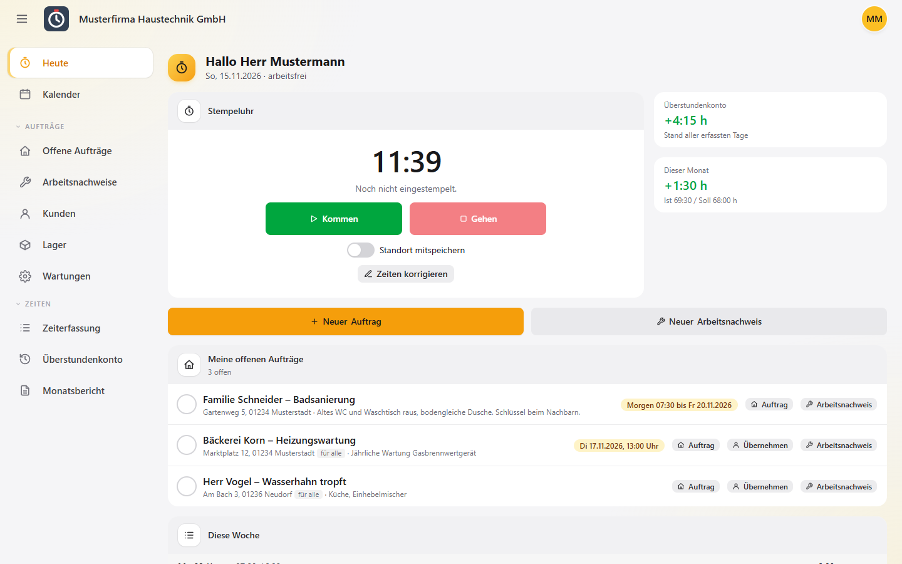
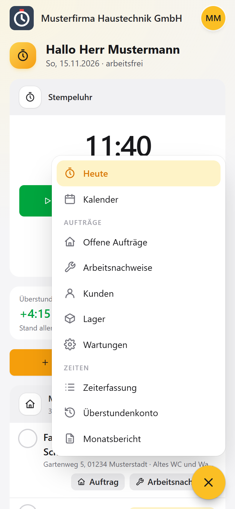
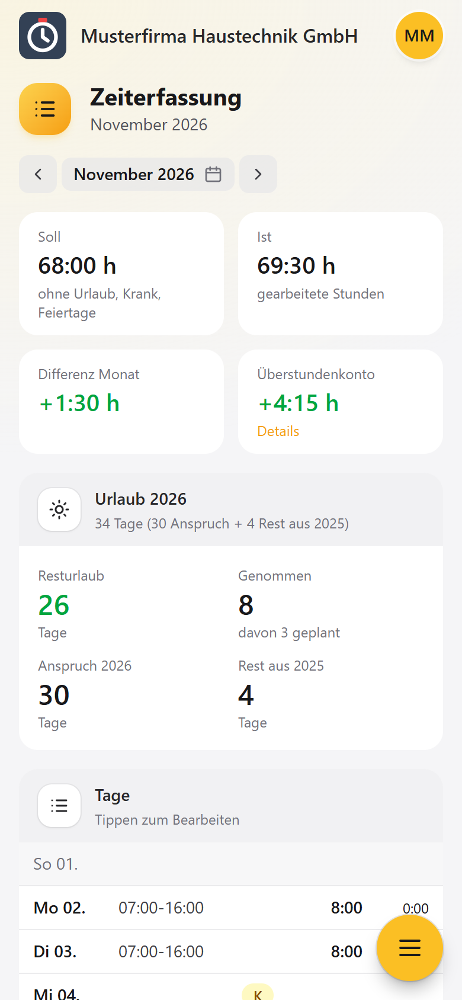
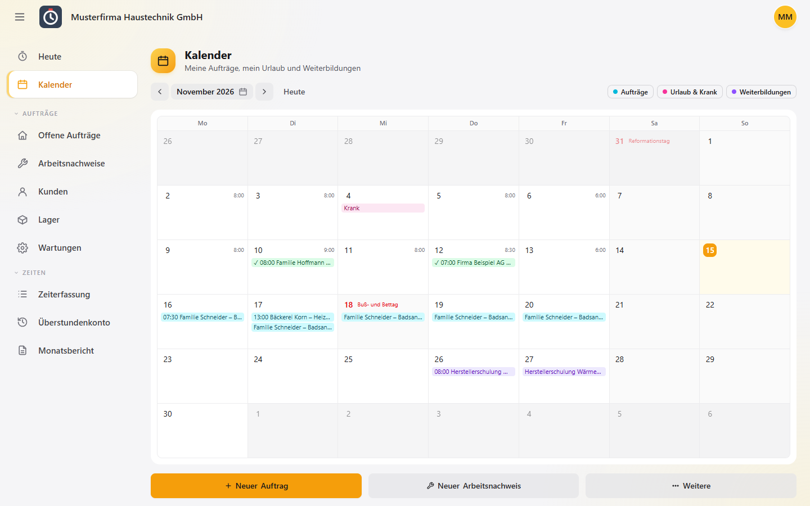
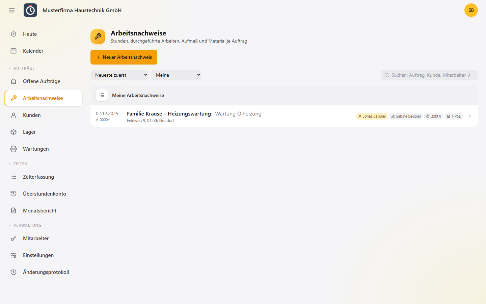
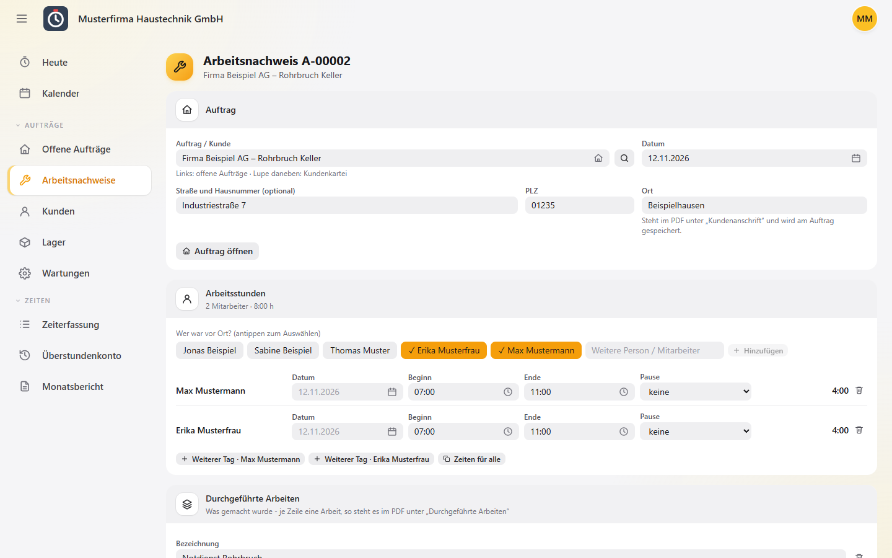
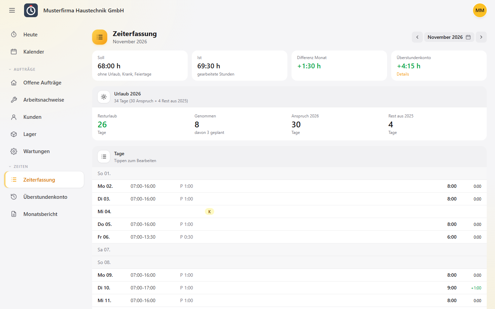
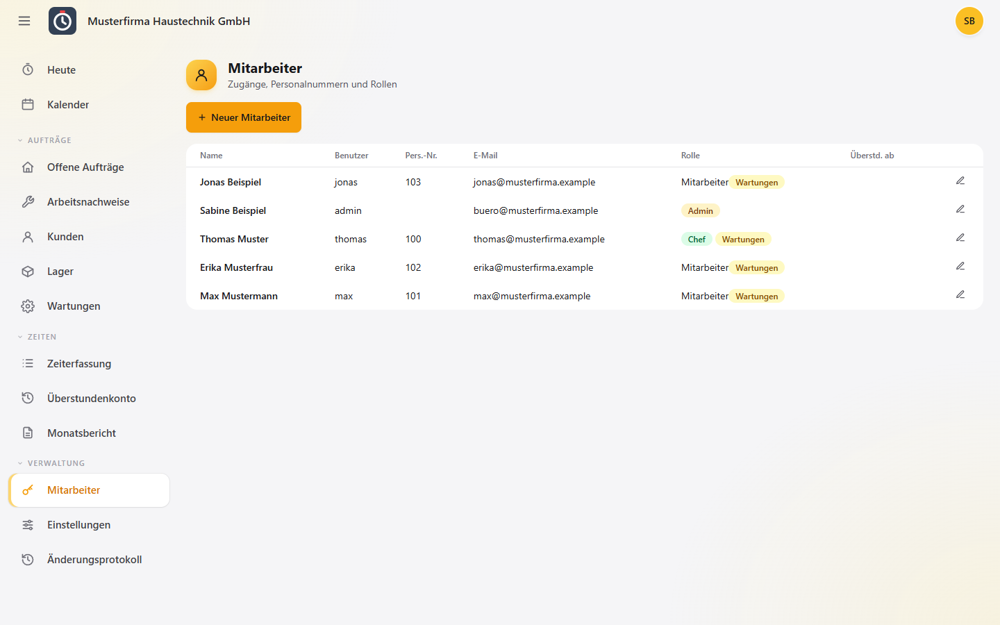
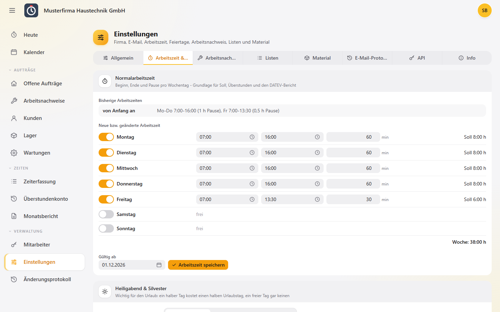
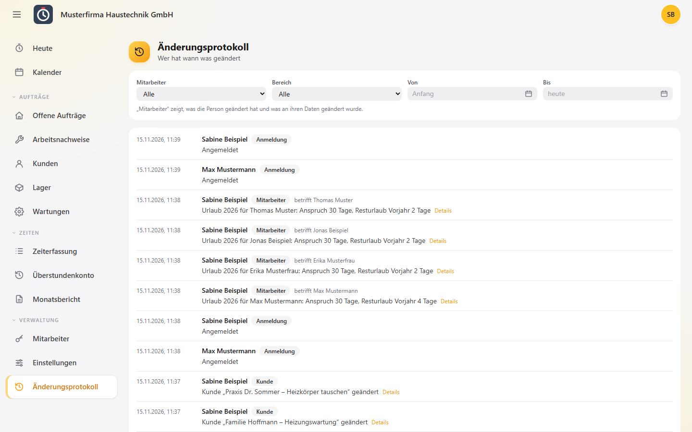

# Zeiterfassung

Zeiterfassung, Aufträge und Arbeitsnachweise für Handwerksbetriebe – im Browser am PC und auf dem Handy, auch als App auf dem Startbildschirm.

> Alle Bilder in dieser Anleitung zeigen ausgedachte Beispieldaten (Musterfirma, Max Mustermann usw.).

**Inhalt**

- [Was die App kann](#was-die-app-kann)
- [Für Mitarbeiter](#für-mitarbeiter)
- [Für den Chef](#für-den-chef)
- [Für Administratoren](#für-administratoren)
- [Wie gerechnet wird](#wie-gerechnet-wird)
- [Installation](#installation) (eigene Anleitung: [INSTALLATION.md](INSTALLATION.md))

---

## Was die App kann

| Bereich | Kurz gesagt |
|---|---|
| **Heute** | Stempeluhr mit *Kommen*, *Pause* und *Gehen*, die eigenen offenen Aufträge und die Woche auf einen Blick |
| **Kalender** | Aufträge mit Termin, Urlaub und Weiterbildungen im Monat |
| **Offene Aufträge** | Aufträge anlegen, übernehmen, planen und abhaken |
| **Arbeitsnachweise** | Was wurde wo von wem wie lange gemacht – mit Material, Fotos und Unterschrift, als PDF oder per E-Mail |
| **Kunden** | Kundenkartei mit Adresse, Telefon und E-Mail, füllt sich von selbst |
| **Lager** | Bestand und Mindestmengen, Bestellliste als PDF |
| **Listen** (z. B. Wartungen) | Eigene Listen nach Schlagworten: wann war z. B. die letzte Wartung beim Kunden, wann ist die nächste fällig |
| **Zeiterfassung** | Der Monat Tag für Tag, mit Urlaub, Krank und Feiertagen |
| **Überstundenkonto** | Stand und Verlauf der Überstunden |
| **Monatsbericht** | Die Arbeitszeit des Monats als PDF für das Lohnbüro (Aufbau wie die DATEV-Vorlage) |

Es gibt drei Arten von Benutzern:

- **Mitarbeiter** sehen nur ihre eigenen Zeiten, ihre Aufträge und die Arbeitsnachweise, auf denen sie stehen.
- **Der Chef** sieht zusätzlich die Zeiten, Berichte und Arbeitsnachweise aller Mitarbeiter und plant die Aufträge.
- **Administratoren** legen Mitarbeiter an, ändern Einstellungen und dürfen Zeiten korrigieren.

Welche Bereiche jemand im Menü sieht, legt der Administrator je Mitarbeiter fest.

---

## Für Mitarbeiter

### Anmelden

Die Adresse der App bekommen Sie von Ihrem Administrator, dazu Benutzername und Passwort. Das Passwort ändern Sie danach selbst unter **Mein Profil** (runder Knopf mit Ihren Initialen oben rechts).

### Heute – die Stempeluhr

Die Startseite. Hier stempeln Sie morgens mit **Kommen** ein und abends mit **Gehen** aus. Mit **Pause** beginnen Sie eine Pause, ein zweiter Druck beendet sie (je nach Einstellung läuft die Pause auch als Countdown ab).

- **Standort mitspeichern**: Auf Wunsch wird beim Stempeln der Standort gespeichert.
- **Zeiten korrigieren**: Haben Sie das Stempeln vergessen, tragen Sie den Tag von Hand ein.
- Rechts sehen Sie Ihr **Überstundenkonto** und wie viele Stunden Sie in diesem Monat schon gearbeitet haben.
- Darunter stehen **Ihre offenen Aufträge** und **Diese Woche**. Ein Tipp auf einen Tag öffnet ihn.
- Mit **Neuer Auftrag** und **Neuer Arbeitsnachweis** legen Sie direkt los.

Vergessen Sie das Ausstempeln, schließt die App den Tag nach einigen Stunden selbst mit der normalen Arbeitszeit. In der Bemerkung steht dann, dass automatisch ausgestempelt wurde.

**Zuordnen:** Gestempelte Zeit, die noch zu keinem Arbeitsnachweis gehört, ist in der Woche rot markiert. Mit **Zuordnen** hängen Sie sie an einen Arbeitsnachweis, einen Auftrag oder einen Kunden.

### Auf dem Handy

Auf dem Handy öffnen sich die Seiten über den runden Knopf unten rechts. Die App lässt sich **wie eine normale App auf den Startbildschirm legen**. Wie das auf Ihrem Handy geht, steht unter *Mein Profil → Als App auf dem Handy*. Stempeln und Eintragen geht auch **ohne Netz**: Die App schickt alles, sobald wieder eine Verbindung da ist.

| Menü auf dem Handy | Zeiterfassung auf dem Handy |
|---|---|
|  |  |

### Kalender

Der Monat mit Ihren Aufträgen (blau), Urlaub und Krankheit (rosa) und Weiterbildungen (lila), dazu Feiertage. Hinter jedem Tag steht die gearbeitete Zeit. Erledigte Aufträge haben ein Häkchen. Ein Tipp auf einen Tag zeigt alles dazu.

### Offene Aufträge

Hier steht alles, was noch zu tun ist.

- **Neuer Auftrag**: Name (z. B. „Familie Schneider – Badsanierung“), Adresse, Auftraggeber, Notiz und Fotos. Ein Termin ist möglich, auch über mehrere Tage oder Wochen.
- Aufträge für **„alle“** kann jeder sehen und bearbeiten. Mit **Übernehmen** machen Sie einen Auftrag zu Ihrem eigenen, mit **Freigeben** geben Sie ihn wieder an alle zurück.
- Mit dem Knopf **Arbeitsnachweis** wird aus dem Auftrag ein Arbeitsnachweis: Adresse, Datum und Ihre Arbeitszeit sind schon eingetragen.
- Ist die Arbeit erledigt, haken Sie den Auftrag mit dem Kreis links ab. Erledigte finden Sie unter **Erledigt**.

### Arbeitsnachweise

Der Arbeitsnachweis ersetzt den Papierzettel. Er enthält:

- **Auftrag und Kundenanschrift.** Über die Lupe finden Sie Kunden aus der Kundenkartei.
- **Arbeitsstunden.** Tippen Sie an, wer vor Ort war. Für jede Person und jeden Tag gibt es eine eigene Zeile mit Beginn, Ende und Pause. Auch Personen von außerhalb lassen sich eintragen.
- **Durchgeführte Arbeiten.** Eine Zeile je Arbeit, dazu Bemerkungen.
- **Material.** Abgetippt, aus dem Materialkatalog gewählt oder als **Foto** (z. B. eine handschriftliche Liste oder ein Lieferschein). Das Foto rückt die App automatisch gerade, wie eine Scanner-App.
- **Fotos** von der Baustelle.
- **Unterschrift**: Ihre Unterschrift, einmal unter *Mein Profil* hinterlegt, kommt automatisch auf das PDF.

Fertig als **PDF** zum Herunterladen oder direkt **per E-Mail** an das Büro oder den Kunden. Jeder Arbeitsnachweis bekommt eine Nummer (A-00001, A-00002 …).

| Liste | Ein Arbeitsnachweis |
|---|---|
|  |  |

In der Liste suchen Sie nach Kunde, Adresse, Arbeit, Material, Mitarbeiter, Datum oder Nummer.

> Überschneiden sich Ihre Zeiten auf zwei Arbeitsnachweisen am selben Tag (z. B. ein Notdienst mitten in einem Baustellentag), kürzt die App die längere Zeile automatisch. So wird keine Stunde doppelt gezählt. Was gekürzt wurde, zeigt die App nach dem Speichern an.

### Kunden

Die Kundenkartei füllt sich von selbst: Jeder Auftrag mit Adresse landet hier. Sie können Telefon, E-Mail und eine Notiz ergänzen und Kunden suchen. Mit einem Tipp auf das Telefon rufen Sie auf dem Handy direkt an.

### Lager

Bestand jedes Materials mit Mindestmenge. Material aus den Arbeitsnachweisen wird automatisch abgebucht, eine Lieferung buchen Sie mit **+** zu. Was unter die Mindestmenge fällt, steht unter **Nachbestellen**. Daraus wird eine **Bestellung als PDF**, auf Wunsch geht sie auch automatisch per E-Mail an die Firma.

### Listen (z. B. Wartungen)

Listen sammeln automatisch alle Arbeitsnachweise, in denen bestimmte **Schlagworte** vorkommen (in der Bezeichnung, der Bemerkung oder bei den durchgeführten Arbeiten). Welche Listen es gibt, legt der Administrator fest. Jede Liste steht mit ihrem eigenen Namen im Menü unter *Aufträge*, z. B.:

| Liste | Schlagworte | Fällig nach |
|---|---|---|
| Wartungen (voreingestellt) | Wartung | 12 Monaten |
| Dichtheitsprüfung | Dichtheitsprüfung, Druckprobe | 60 Monaten |
| Notdienst | Notdienst, Rohrbruch | keine Fälligkeit |

Jede Liste hat zwei Ansichten:

- **Alle Einträge**: alle passenden Arbeitsnachweise mit Datum, Kunde, Adresse, Arbeit und Mitarbeiter, mit Suche und Sortierung.
- **Je Kunde (letzte)**: der letzte Eintrag je Kunde und, wenn die Liste eine Fälligkeit hat, wann der nächste fällig ist. **Gelb** heißt bald fällig (in den nächsten 30 Tagen), **rot** heißt überfällig. So sehen Sie z. B. auf einen Blick, bei welchen Kunden die nächste Wartung ansteht.

Ein Tipp auf einen Eintrag öffnet den Arbeitsnachweis.

### Zeiterfassung

Ihr Monat Tag für Tag: Beginn, Ende, Pause, Stunden und was davon Über- oder Minderstunden sind. Oben stehen Soll, Ist, die Differenz des Monats und Ihr Urlaub (Resturlaub, genommen, geplant).

Ein Tipp auf einen Tag öffnet ihn zum Bearbeiten. Statt Zeiten gibt es Kürzel:

| Kürzel | Bedeutung |
|---|---|
| **U** | Urlaub (auch als Zeitraum eintragbar, Wochenenden und Feiertage werden übersprungen) |
| **UU** | unbezahlter Urlaub |
| **K** | krank |
| **SU** / **SA** | stundenweise Urlaub / stundenweise abwesend (mit Zeiten) |
| **FA** | Freizeitausgleich (baut Überstunden ab) |
| **F** | Feiertag |

### Überstundenkonto

Ihr aktueller Stand und der Verlauf Monat für Monat. Darunter stehen Auszahlungen und Korrekturen, die das Büro gebucht hat.

### Monatsbericht

Der Bericht für das Lohnbüro im Aufbau der DATEV-Vorlage *„Dokumentation der täglichen Arbeitszeit“*. Sie sehen ihn als Vorschau, laden ihn als **PDF** herunter oder schicken ihn **per E-Mail**. Hier können Sie auch wählen, Überstunden mit diesem Monat **auszahlen** zu lassen.

### Mein Profil, Darstellung, Abmelden

Der runde Knopf mit Ihren Initialen oben rechts öffnet:

- **Mein Profil**: Name, Anrede, E-Mail und **Passwort** ändern, **Unterschrift** hinterlegen (für Arbeitsnachweise und Monatsbericht), Anleitung **„Als App auf dem Handy“**
- **Darstellung**: hell oder dunkel, Glas-Effekt, Farbe
- **Abmelden**

---

## Für den Chef

Der Chef hat alles, was Mitarbeiter haben, und zusätzlich:

- **Zeiterfassung, Überstundenkonto und Monatsbericht aller Mitarbeiter** ansehen und herunterladen (oben einen Mitarbeiter wählen)
- **Alle Arbeitsnachweise** sehen
- **Aufträge planen**: für alle anlegen, Mitarbeitern zuweisen, ändern, abhaken und löschen
- **Kalender** für alle oder einen Mitarbeiter, dazu **Weiterbildungen** anlegen. Wer teilnimmt, bekommt an diesen Tagen automatisch die normale Arbeitszeit eingetragen.
- **Urlaubsanspruch** und Resturlaub der Mitarbeiter einstellen

---

## Für Administratoren

Administratoren sehen alles und haben unten im Menü den Bereich **Verwaltung**.

### Erster Start

1. Mit dem Benutzer **admin** und dem Startpasswort anmelden. Das Startpasswort wird bei der Einrichtung angezeigt (siehe [Installationsanleitung](INSTALLATION.md)).
2. Unter **Mein Profil** das Passwort ändern und den eigenen Namen eintragen.
3. Unter **Einstellungen → Allgemein** Firmenname, Anschrift, Telefon, E-Mail und Logo eintragen. Das erscheint auf Arbeitsnachweisen und Berichten.
4. Den **E-Mail-Versand** einrichten (Einstellungen → Allgemein). Die Zugangsdaten bekommen Sie von Ihrem E-Mail-Anbieter. Mit „Test-Mail“ prüfen Sie, ob es klappt.
5. Unter **Einstellungen → Arbeitszeit & Feiertage** Arbeitszeiten und Bundesland prüfen.
6. Unter **Mitarbeiter** die Kollegen anlegen.

### Mitarbeiter

Hier legen Sie Mitarbeiter an und bearbeiten sie: Benutzername, Name, Personalnummer, E-Mail und Startpasswort. Außerdem:

- **Rolle**: Mitarbeiter, Chef oder Administrator
- **Sichtbare Bereiche**: welche Seiten der Mitarbeiter im Menü hat. Jede Liste ist ein eigener Bereich, z. B. „Wartungen“ nur für Servicemonteure oder „Lager“ nur fürs Lager.
- **Urlaub**: Anspruch pro Jahr und Rest aus dem Vorjahr
- **Ohne feste Arbeitszeiten**: für Aushilfen ohne Sollzeit
- **Überstunden zählen ab** einem bestimmten Datum, mit Übertrag aus der Zeit davor
- **Deaktivieren**: Der Mitarbeiter kann sich nicht mehr anmelden, seine Daten bleiben erhalten.

### Einstellungen

| Reiter | Was Sie dort einstellen |
|---|---|
| **Allgemein** | Firma (Name, Zusatzzeile, Anschrift, Telefon, E-Mail, Logo), Stempeluhr (Pause-Taste, automatisch ausstempeln nach … Stunden, Standort, früher Kommen), E-Mail-Versand und Empfänger, Monatsbericht |
| **Arbeitszeit & Feiertage** | Normalarbeitszeit je Wochentag mit Beginn, Ende und Pause, jeweils **gültig ab** einem Datum (frühere Monate bleiben unverändert), Heiligabend und Silvester (voll, halb oder frei), eigene freie Tage, Bundesland für die Feiertage |
| **Arbeitsnachweis** | Aussehen des PDFs (Layout und Farbe) mit Vorschau |
| **Listen** | Eigene Listen anlegen, ändern oder entfernen (bis zu 20): **Name** (so steht die Liste im Menü), **Schlagworte** (mit Komma getrennt, bis zu 10) und **Fällig nach** wie vielen Monaten (0 = keine Fälligkeit). „Wartungen“ ist voreingestellt. Eine neue Liste danach unter *Mitarbeiter* für die gewünschten Personen freischalten. |
| **Material** | Gemeinsamer Materialkatalog für die Arbeitsnachweise |
| **E-Mail-Protokoll** | Welche E-Mails wann an wen gingen |
| **API** | Zugang für Apps und Programme ein- oder ausschalten |
| **Info** | Version der App und verwendete Datenbank |

| Allgemein | Arbeitszeit |
|---|---|
|  |  |

### Korrigieren und buchen

- **Zeiten korrigieren**: Unter *Zeiterfassung* einen Mitarbeiter wählen und den Tag bearbeiten.
- **Überstunden buchen**: Unter *Überstundenkonto* lassen sich Auszahlungen, Korrekturen und Überträge buchen.

### Änderungsprotokoll

Jede Änderung wird festgehalten: wann, wer und was vorher und nachher drinstand. Das gilt für Zeiten, Stempelungen, Urlaub, Überstunden, Arbeitsnachweise, Aufträge, Material, Mitarbeiter und Einstellungen, auch für An- und Abmeldungen. Sie können nach Mitarbeiter, Bereich und Zeitraum filtern. Passwörter werden nie gespeichert. Nur Administratoren sehen das Protokoll.

---

## Wie gerechnet wird

- **Soll** ist die Normalarbeitszeit des Tages (voreingestellt Mo–Do 8 Stunden, Fr 6 Stunden; einstellbar). **Ist** ist die gearbeitete Zeit ohne Pausen. Die Differenz geht ins **Überstundenkonto**.
- **Urlaub, Krankheit, unbezahlter Urlaub und Feiertage** haben keine Stunden. Sie zählen nicht zum Soll und ändern das Überstundenkonto nicht.
- **Freizeitausgleich (FA)** zieht die Sollzeit des Tages vom Überstundenkonto ab.
- Wer an einem **Wochenende oder Feiertag** arbeitet, trägt die Zeit normal ein. Sie zählt komplett als Überstunden.
- **Pausen**: Es zählen die mit der Pause-Taste genommenen Pausen. Ohne sie gilt die normale Pause des Tages. Mindestens gilt aber immer die gesetzliche Pause (30 Minuten ab 6 Stunden, 45 Minuten ab 9 Stunden).
- **Feiertage** kommen automatisch aus dem eingestellten Bundesland. Örtliche Feiertage lassen sich als eigene Tage ergänzen.
- **Monatsbericht für das Lohnbüro**: Darin steht jeder Arbeitstag mit der **normalen Arbeitszeit**, egal wie lange tatsächlich gearbeitet wurde. Mehr- oder Minderstunden landen nur im internen Überstundenkonto. Ausgezahlte Überstunden kann der Administrator wahlweise auf dem Bericht ausweisen lassen.

---

## Installation

Wie Sie die App auf einem Server einrichten (mit nginx, Apache oder Plesk), aktualisieren und sichern, steht in der **[Installationsanleitung](INSTALLATION.md)**.

---

Oberfläche: **One UI** von [AuxXxilium](https://auxxxilium.tech), Design von [Fulcrum](https://github.com/FulcrumCode). Der Monatsbericht ist dem Aufbau der DATEV-Vorlage „Dokumentation der täglichen Arbeitszeit“ nachgebildet; Logo und Copyright-Vermerk von DATEV werden nicht übernommen.
